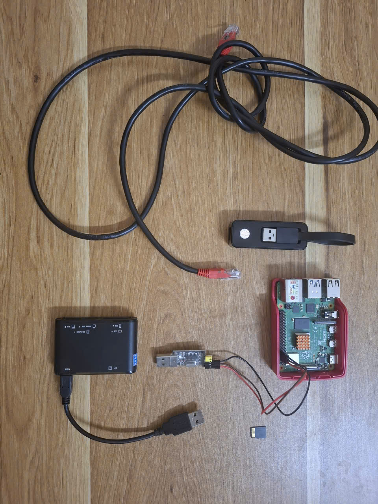

# rpi4-router-project

A personal project for building a custom Linux image for Raspberry Pi 4 Model B using Buildroot inside Docker.

This project provides a custom Linux image to turn the Raspberry Pi 4 into a router, along with a development environment for further feature integration.

## What this project does

- Uses Buildroot to generate a Linux image for Raspberry Pi 4
- Provides a Docker-based build environment that ensures dependencies are consistent across machines
- Keeps board-specific configuration and overlay files under the project tree

## Technical requirements

Before starting, make sure you have the following hardware and software ready:

### Software & Environment

- **Host Machine:** A Linux-based system (or WSL2) with **Docker** and **Git** installed.

### Hardware & Peripherals

- **Target Board:** Raspberry Pi 4 Model B.
- **Storage:** A microSD card (16GB+ recommended) and a card reader.
- **Console Debugging:** A USB-to-TTL 3.3V Serial Cable (UART) for serial logs.
- **Networking:** An Ethernet cable and a USB-to-Ethernet adapter.

## Quick start

1. Clone the repository:

```bash
git clone <the-repo-url>
cd rpi4-router-project
```
2. Prepare the Buildroot environment:

```bash
./setup.sh
```
This script will:

- check that Docker and Git are available
- clone Buildroot into the `buildroot/` directory if needed
- link the custom `khainpm` board configuration into the Buildroot tree

3. Build the docker environment:

If you have not added your user to the `docker` group yet, run the following commands once to use Docker without `sudo`:

```bash
sudo usermod -aG docker $USER
newgrp docker
```

Then start the container with:

```bash
./build-container.sh
```

This script will:

- build the Docker image for the project
- start a container with the repository mounted at `/workspace`
- launch an interactive shell so you can run Buildroot commands inside the container

4. Configure

```bash
cd ./buildroot/
make BR2_DEFCONFIG=/workspace/buildroot/board/khainpm/router-pi4/rpi4_buildroot_defconfig defconfig
```

5. Build the System Image

```bash
make -j$(nproc)
```

The generated image files will be placed under:

```bash
buildroot/output/images/sdcard.img
```

## Project structure

```text
.
├── Dockerfile               # Container environment for building
├── build-container.sh       # Builds and starts the Docker container
├── setup.sh                 # Prepares Buildroot and board configuration
├── khainpm/                 # Custom board config and rootfs overlay
├── buildroot/               # Buildroot source tree
└── README.md
```
## Packages
- dnsmasq: assigns DHCP and provides DNS for devices on the LAN.
- iproute2: provides routing management tools.
- nftables: manages firewall and NAT.
- dropbear: provides SSH access for debugging and system access.
- wpa_supplicant: enables Wi-Fi client connectivity and WPA/WPA2 authentication.
- iw: provides wireless interface configuration tools for Linux.
- iperf3: measures network throughput and performance between hosts.
- tcpdump: captures and inspects network traffic for debugging.

## Network topology
                     + - - - - - - - - - - - - +
                     :   Wi-Fi Access Point    :
                     :     (Home Router)       :
                     + - - - - - - - - - - - - +
                                  :
                                  : (Wi-Fi 802.11)
                                  v
                   + - - - - - - - - - - - - - - +
                   : [wlan0] (WAN interface)     :
                   :                             :
                   :    Raspberry Pi 4 Router    :
                   :    (Buildroot Linux)        :
                   :                             :
                   :    - IP Forwarding / NAT    :
                   :    - Netfilter              :
                   :                             :
                   :                             :
                   : [eth0] (LAN Gateway)        :
                   + - - - - - - - - - - - - - - +
                                  :
                                  : (Ethernet LAN - 192.168.10.1/24)
                                  :
                                  v
          + - - - - - - - - - - - - - - - - - - - - - - - - +
          :                    Host PC                      :
          :                                                 :
          + - - - - - - - - - - - - - - - - - - - - - - - - +

## Results

### router interfaces

```text
# ifconfig
eth0      Link encap:Ethernet  HWaddr D8:3A:DD:3D:43:F8  
          inet addr:192.168.10.1  Bcast:0.0.0.0  Mask:255.255.255.0
          inet6 addr: fe80::da3a:ddff:fe3d:43f8/64 Scope:Link
          UP BROADCAST MULTICAST  MTU:1500  Metric:1
          RX packets:9739 errors:0 dropped:0 overruns:0 frame:0
          TX packets:7389 errors:0 dropped:279 overruns:0 carrier:0
          collisions:0 txqueuelen:1000 
          RX bytes:6718133 (6.4 MiB)  TX bytes:4497205 (4.2 MiB)

lo        Link encap:Local Loopback  
          inet addr:127.0.0.1  Mask:255.0.0.0
          inet6 addr: ::1/128 Scope:Host
          UP LOOPBACK RUNNING  MTU:65536  Metric:1
          RX packets:0 errors:0 dropped:0 overruns:0 frame:0
          TX packets:0 errors:0 dropped:0 overruns:0 carrier:0
          collisions:0 txqueuelen:1000 
          RX bytes:0 (0.0 B)  TX bytes:0 (0.0 B)

wlan0     Link encap:Ethernet  HWaddr D8:3A:DD:3D:43:F9  
          inet addr:192.168.1.102  Bcast:192.168.1.255  Mask:255.255.255.0
          inet6 addr: fe80::da3a:ddff:fe3d:43f9/64 Scope:Link
          UP BROADCAST RUNNING MULTICAST  MTU:1500  Metric:1
          RX packets:8129 errors:0 dropped:0 overruns:0 frame:0
          TX packets:9944 errors:0 dropped:8 overruns:0 carrier:0
          collisions:0 txqueuelen:1000 
          RX bytes:4517643 (4.3 MiB)  TX bytes:6775871 (6.4 MiB)

```
### Internet connectivity

```text
# ping google.com
PING google.com (142.250.198.206): 56 data bytes
64 bytes from 142.250.198.206: seq=0 ttl=111 time=25.776 ms
64 bytes from 142.250.198.206: seq=1 ttl=111 time=39.020 ms
64 bytes from 142.250.198.206: seq=2 ttl=111 time=31.232 ms
^C
--- google.com ping statistics ---
3 packets transmitted, 3 packets received, 0% packet loss
round-trip min/avg/max = 25.776/32.009/39.020 ms
```
### LAN Throughput (LAN host (192.168.10.6) -> RPI4 WAN interface (192.168.1.102))

```text
iperf3 -c 192.168.1.102 -B 192.168.10.6 -p 3000
Connecting to host 192.168.1.102, port 3000
[  5] local 192.168.10.6 port 34745 connected to 192.168.1.102 port 3000
[ ID] Interval           Transfer     Bitrate         Retr  Cwnd
[  5]   0.00-1.00   sec   108 MBytes   904 Mbits/sec    0    218 KBytes       
[  5]   1.00-2.00   sec   107 MBytes   895 Mbits/sec    0    240 KBytes       
[  5]   2.00-3.00   sec   107 MBytes   899 Mbits/sec    0    240 KBytes       
[  5]   3.00-4.00   sec   107 MBytes   894 Mbits/sec    0    240 KBytes       
[  5]   4.00-5.00   sec   107 MBytes   899 Mbits/sec    0    240 KBytes       
[  5]   5.00-6.00   sec   107 MBytes   897 Mbits/sec    0    240 KBytes       
[  5]   6.00-7.00   sec   107 MBytes   895 Mbits/sec    0    252 KBytes       
[  5]   7.00-8.00   sec   107 MBytes   900 Mbits/sec    0    252 KBytes       
[  5]   8.00-9.00   sec   107 MBytes   901 Mbits/sec    0    348 KBytes       
[  5]   9.00-10.00  sec   107 MBytes   895 Mbits/sec    0    348 KBytes       
- - - - - - - - - - - - - - - - - - - - - - - - -
[ ID] Interval           Transfer     Bitrate         Retr
[  5]   0.00-10.00  sec  1.05 GBytes   898 Mbits/sec    0            sender
[  5]   0.00-10.00  sec  1.04 GBytes   896 Mbits/sec                  receiver

```

### Storage & Image Footprint

| Component | File | Size | Description |
| :--- | :--- | :--- | :--- |
| **Flash Image** | `sdcard.img` | **153 MB** | Complete image for SD card flashing |
| **RootFS** | `rootfs.ext2/4` | **120 MB** | Ext filesystem partition (BusyBox-based) |
| **Boot Partition**| `boot.vfat` | **32 MB** | FAT32 bootloader & config partition |
| **Kernel Binary** | `Image` | **24 MB** | Uncompressed ARM64 Linux Kernel |


## References & Documentation

- [Buildroot Official User Manual (PDF)](https://nightly.buildroot.org/manual.pdf) — Comprehensive guide for system configuration, package management, and architecture integration.
- [Raspberry Pi Documentation](https://www.raspberrypi.com/documentation/) — Official hardware specs, bootloader configurations, and peripheral documentation for Raspberry Pi 4.
- [Docker Documentation](https://docs.docker.com/) — Reference guide for containerization and bind-mount configurations.

## Images
